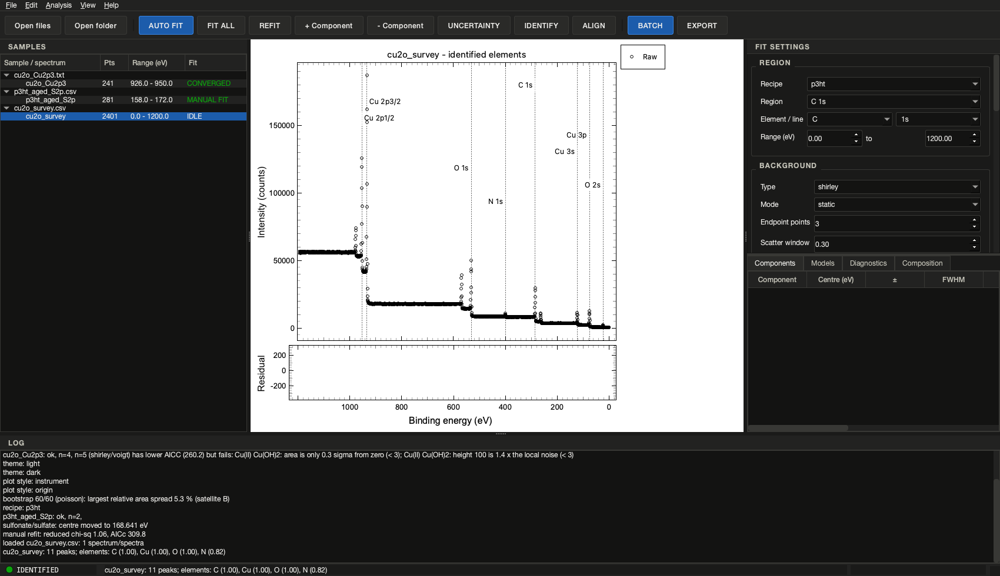

<h1 align="center">XPS AutoFit Studio</h1>

<p align="center">
<b>Automated, reproducible X-ray photoelectron spectroscopy (XPS) peak fitting.</b><br>
Physics-constrained model selection · active Shirley/Tougaard backgrounds · survey element identification ·
batch processing · a desktop application · one project file that reproduces every number.
</p>

<p align="center">
<a href="https://github.com/jongsu-king/xps-autofit-studio/actions/workflows/ci.yml"></a>
<a href="https://github.com/jongsu-king/xps-autofit-studio/actions/workflows/installers.yml"></a>
<a href="https://github.com/jongsu-king/xps-autofit-studio/releases/latest"></a>
<a href="https://github.com/jongsu-king/xps-autofit-studio/releases"></a>


<a href="LICENSE"></a>
<a href="https://doi.org/10.5281/zenodo.24071088"></a>
</p>

<p align="center">
<a href="https://github.com/jongsu-king/xps-autofit-studio/releases/latest"><b>Download installers</b></a> ·
<a href="docs/algorithm.md">How the fit decides</a> ·
<a href="docs/gui.md">Desktop application</a> ·
<a href="docs/recipes.md">Recipes</a> ·
<a href="docs/installers.md">Installers</a> ·
<a href="CHANGELOG.md">Changelog</a> ·
<a href="#한국어-요약">한국어</a>
</p>


## Why

Peak fitting is where XPS results become arguable. The same spectrum fitted by two
people gives two component counts, two sets of widths and two compositions, and the
choices that produced them rarely survive into the paper. XPS AutoFit Studio makes
those choices explicit, physical and repeatable:

- **The number of components is decided by statistics and physics together.** Every
  candidate model must pass physical checks (significant area, height above the
  noise, centres inside the region, minimum separation, spin-orbit splitting and
  area ratio) before AICc/BIC may prefer it; a structured residual (Durbin-Watson)
  breaks ties. Ambiguous or non-physical results are reported as such instead of
  being reported as answers.
- **The background can be fitted, not guessed.** Besides the classical endpoint
  Shirley and Tougaard, the background can be generated from the fitted peaks
  inside the fit (*active* mode), which removes the endpoint and tail bias.
- **Every fit carries a grade (A-E) and its reasons**, the parameter correlations
  that say whether two components are really determined independently, and
  bootstrap uncertainties propagated down to the atomic percentages.
- **Outliers do not steer the result**: a robust loss and a spike mask handle
  cosmic-ray hits and detector glitches.
- **A survey tells you what is in the sample** before you fit anything: elements
  are identified from their principal and Auger lines with a confidence and the
  overlaps named.
- **Everything reproduces.** A project file stores data, settings, starts and
  versions; `xps-autofit verify` re-runs it and compares to 1e-6. The same recipe
  applied to a hundred files gives a hundred comparable results, not a hundred
  judgement calls.

If this saves you an afternoon, a star on the repository helps other XPS users find it.

## Features

| | |
|---|---|
| **Input** | CSV / TXT / TSV / DAT / XY exports (sniffed delimiter, header-based column choice, decimal commas, descending axes, kinetic-energy columns), Excel workbooks `.xlsx` / `.xlsm` (one sheet per region, one column per sample, side-by-side pairs, vendor exports with background / envelope / peak columns) and ISO 14976 VAMAS `.vms` |
| **Backgrounds** | Linear, Shirley, Tougaard; *static* (endpoints, optional free linear refinement) or *active* (generated from the fitted envelope with free offset and a scattering factor bounded around the endpoint estimate); `auto` tries them all |
| **Line shapes** | Gaussian, Lorentzian, Voigt, pseudo-Voigt (sum, SGL), GL product (CasaXPS `GL(p)`), asymmetric Doniach-Šunjić (metals), area-normalised; `auto` chooses |
| **Constraints** | Spin-orbit doublets as one component (splitting, area ratio, shared widths), width bounds, shared widths, candidate windows for chemical states, minimum separation |
| **Model selection** | AICc / BIC among models that pass the physical checks, parsimony margin, residual diagnostics (Durbin-Watson, runs test, lag-1), multi-start and optional differential-evolution search |
| **Robustness** | Robust loss (`soft_l1`, `huber`, `cauchy`, `arctan`), spike mask, parameter-correlation and relative-error warnings |
| **Quality grade** | A-E per candidate with every deduction listed, in the report, the tables and the app |
| **Uncertainties** | Covariance errors; Poisson or residual bootstrap of areas, centres, widths, fractions, propagated to atomic percentages |
| **Survey identification** | 62 elements, 164 lines (photoelectron and Auger); confidence, matched/missing lines, ambiguities, charge-shift correction |
| **Quantification** | Relative composition from RSFs (Scofield table or recipe values), optional escape-depth / transmission exponents, `NOT_CALCULABLE` when a factor is missing, modified Auger parameter for Cu |
| **Outputs** | CSV, XLSX, JSON project, PNG/SVG/PDF figures, per-run summaries; `verify` reproduces a project |
| **Desktop app** | Instrument-style PySide6/PyQtGraph window in a dark or light theme: sample tree, live plot with draggable centre lines (Origin-style publication look or a theme-following instrument style), settings panel, Components / Models / Diagnostics / Composition tabs, FIT ALL, charge alignment, undo/redo, editable titles and names, comparison view (overlay, normalise, stack), bootstrap, batch, export, element identification, update notice |
| **Installers** | Windows setup + zip, macOS DMG (Apple Silicon), Debian/Ubuntu `.deb` + tar.gz, built and smoke-tested on every release |

## Install

**Installers (no Python needed)** are attached to every
[release](https://github.com/jongsu-king/xps-autofit-studio/releases/latest):

| Platform | File |
|---|---|
| Windows 10/11 x64 | `XPS-AutoFit-Studio-<version>-Windows-x64-Setup.exe` (or the portable `.zip`) |
| macOS 12+ Apple Silicon | `XPS-AutoFit-Studio-<version>-macOS-arm64.dmg` |
| Debian / Ubuntu x64 | `xps-autofit-studio_<version>_amd64.deb` (or the portable `.tar.gz`) |

Each contains the desktop application and the `xps-autofit` command-line tool. The
builds are not code-signed; `docs/installers.md` has the SmartScreen / Gatekeeper
steps and the checksums are in `SHA256SUMS.txt`. The application tells you when a
newer release exists (once a day, can be turned off).

**Python package** (3.11 or later):

```bash
pip install xps-autofit            # engine + command line
pip install "xps-autofit[gui]"     # plus the desktop application (PySide6, PyQtGraph)
```

**From a clone** (development):

```bash
pip install -e ".[dev,gui]"
pytest
```

## Quick start

```bash
# Example data with known truth (several formats, including a survey)
xps-autofit synth --out examples/data

# What is in the sample?  Elements identified from a survey scan
xps-autofit identify examples/data/cu2o_survey.csv

# What is in a file?
xps-autofit info examples/data/p3ht_aged_multi.vms

# Fit with a built-in recipe; the report shows the grade of every region
xps-autofit fit examples/data/p3ht_aged_S2p.csv --recipe p3ht --output results

# Ad-hoc region: Shirley background, Voigt doublet (S 2p), up to 3 components
xps-autofit fit s2p.csv --range 160 172 --doublet 1.18 0.5 --max-components 3

# Metallic Au 4f: active Shirley background and the asymmetric Doniach-Sunjic line
xps-autofit fit au4f.csv --range 80 92 --doublet 3.67 0.75 \
    --background shirley --background-mode active --shape doniach_sunjic

# Spiky detector? Robust loss and a spike mask
xps-autofit fit c1s.csv --range 280 294 --loss soft_l1 --mask-spikes 6

# CasaXPS-style GL(30) product line shape, active Shirley background
xps-autofit fit c1s.csv --range 280 294 --shape gl_product --background shirley --background-mode active

# Uncertainties: 200 bootstrap replicates, propagated to the atomic percentages
xps-autofit fit sample.vms --recipe cbo --bootstrap 200 --output results

# Same recipe for a whole folder; summary tables compare samples
xps-autofit batch ./spectra --recipe cu2o --output results --formats csv,xlsx,json,png

# Re-run a saved project and confirm the numbers reproduce
xps-autofit verify results/p3ht_aged_S2p__S_2p.json

# Is there a newer release?
xps-autofit update-check
```

From Python:

```python
from xps_autofit import read_spectra
from xps_autofit.automation.identify import identify_elements
from xps_autofit.automation.model_selection import select_model
from xps_autofit.recipes import load_recipe

survey = read_spectra("survey.vms")[0]
for cand in identify_elements(survey).candidates:
    print(cand.element, round(cand.confidence, 2), [m.label for m in cand.matched])

spectrum = read_spectra("p3ht_aged_S2p.csv")[0]
region = load_recipe("p3ht").region("S 2p")
selection = select_model(spectrum, region)
best = selection.best
print(selection.status, best.grade.letter, best.grade.reasons)   # ok A []
for c in best.result.components:
    print(c.label, round(c.center, 2), round(c.area), c.fraction)
```

## Desktop application

```bash
xps-autofit gui
```

The window follows the layout of instrument software: a sample tree on the left,
the live spectrum in the centre (raw data, background, components with draggable
centre lines, envelope, residual with the ±1σ band, cursor readout), fit settings
and the Components / Models / Diagnostics tabs on the right, a log at the bottom
and a status lamp (IDLE, FITTING, CONVERGED, AMBIGUOUS, NEEDS REVIEW, MANUAL FIT).
AUTO FIT runs the same model selection as the command line in a background
thread; dragging a centre line, editing a cell or adding / removing a component
refits; UNCERTAINTY bootstraps the displayed fit; IDENTIFY lists the elements of a
survey and marks their lines; EXPORT and BATCH write exactly the files the CLI
writes. Files and folders can be dropped on the window; tables copy to the
clipboard; a newer release shows as a link in the status bar. Details and
screenshots in `docs/gui.md`.




## Recipes

A recipe is a YAML file with one entry per region: energy range, background,
peak shape, width bounds, doublet definition, candidate chemical states with
windows, the allowed number of components, robustness options and the RSF.
Built-in recipes:

| Recipe      | Regions                                 | Purpose                                              |
|-------------|-----------------------------------------|------------------------------------------------------|
| `p3ht`      | C 1s, S 2p                              | Thiophene S 2p doublet and sulfur oxidation          |
| `cu2o`      | Cu 2p3/2, Cu LMM, O 1s, C 1s            | Cu states, satellites, Auger parameter (Cu(0)/Cu(I)) |
| `cbo`       | Cu 2p3/2, Bi 4f, O 1s, C 1s             | CuBi2O4: Cu/Bi states; composition when RSFs given   |
| `sam_2pacz` | P 2p, N 1s, C 1s, O 1s                  | Phosphonic-acid SAM formation                        |

`xps-autofit recipes --show p3ht` prints a recipe; copy it, edit it and pass the
path with `--recipe my_recipe.yaml`.

Candidate positions and spin-orbit data are typical literature values collected in
`xps_autofit.database`. They constrain fits and suggest assignments; they are not a
substitute for your own references.

## How the automatic fit decides

For each component count *n* from `min_components` to `max_components` the program
fits several starts (detected peaks and shoulders, residual-guided additions,
jittered copies) and keeps the best. Each model is then checked:

| Check                               | Effect                      |
|-------------------------------------|-----------------------------|
| Area < 3 sigma from zero            | model rejected              |
| Height < 3 x local noise            | model rejected              |
| Centre at the region edge           | model rejected              |
| Two majors closer than `min_separation` | model rejected          |
| Width pinned at a bound             | warning                     |
| Centre outside all candidate windows | warning (or rejection with `require_assignment: true`) |
| Residual autocorrelated (Durbin-Watson < 1) | warning; breaks ties towards the model with a white residual |
| Two components' parameters > 98 % correlated | warning: not independently determined |
| Area uncertain by > 50 %            | warning                     |

Among the accepted models the lowest AICc (default) or BIC wins. If the next model
is within 2 units the result is `ambiguous` and the simpler model is reported -
unless the simpler model leaves a structured residual and the richer one does not.
If nothing passes, the statistically best model is returned with status
`needs_review`. Each candidate also receives a **grade** A-E (chi-square, residual
structure, violations, warnings, standard errors, degeneracy, convergence) with its
deductions listed, so a batch can be triaged at a glance. With `background:
{type: auto, mode: auto}` and `shape: auto` the background and the line shape are
chosen the same way. The full procedure is in `docs/algorithm.md`.

Doublets are one component: the minor line is tied to the major by
`center + splitting`, `area * ratio` and shared widths, so S 2p3/2 and 2p1/2 are
never interpreted as two chemical species.

### Charge referencing

Recipes may define a charge reference (for example adventitious C 1s at 284.8 eV).
It is applied only when that region is present and prints a warning every time:
the adventitious-carbon position varies between samples (Greczynski & Hultman 2020).
Use `--no-charge-correction` to disable it; the applied shift is stored in every
output.

## Outputs

For each file and region (`<file>__<region>`):

- `_components.csv` - centre, FWHM, area with standard errors, fraction, Gaussian /
  Lorentzian widths, asymmetry
- `_fit.csv` - energy, raw, background, net, envelope, residual, each component
- `_models.csv` / `_models.png` - every candidate model with AICc, BIC, chi-square,
  Durbin-Watson, largest correlation, grade and the physical checks
- `.png` / `.svg` / `.pdf` - publication figure with residual panel
- `.json` - project file: data, settings, initial values, parameters, mask,
  correlations, grade, versions
- `.xlsx` - the same tables in one workbook

Per run: `summary_regions.csv` (with `grade`, `quality_score`, `durbin_watson`,
`max_correlation`), `summary_components.csv`, `summary_quantification.csv` (and
`summary.xlsx`).

Standard errors come from the covariance matrix (rescaled by reduced chi-square
only for unweighted fits). `--bootstrap N` adds Poisson or residual bootstrap
standard deviations and percentiles (areas, centres, widths, fractions) to the
project file and propagates them to the atomic percentages in
`summary_quantification.csv`.

## File formats

| Format | Notes |
|--------|-------|
| CSV / TSV / TXT / DAT / XY / ASC | Delimiter sniffed; header used to find energy and intensity columns; decimal commas; descending axes; several numeric blocks per file; `Kinetic Energy` columns converted (photon energy from `--photon-energy`, default Al K-alpha 1486.6 eV) |
| Excel `.xlsx` / `.xlsm` | Every worksheet scanned for numeric tables; energy column by header (`Binding Energy (eV)`, `BE`, `KE`, `eV`) or as the monotonic column; one sheet per region, one intensity column per sample on a shared axis, energy/intensity pairs side by side, several tables per sheet; vendor `Background` / `Envelope` / `Residual` / peak columns skipped in favour of the measured `Counts / s`; `Photon energy`, `Dwell time`, `Number of scans` rows used; sheet or table titles like `C1s Scan` matched to recipe regions; `--sheet`, `--energy-col`, `--intensity-col` override |
| VAMAS `.vms` | ISO 14976 NORM / REGULAR and IRREGULAR scans; kinetic energy converted with the source energy; dwell time and scans kept for weights. Files with parameter inclusion/exclusion lists are rejected with a message |

Intensity in **counts** enables Poisson weighting. For **cps** files weights need the
dwell time and number of scans (read from VAMAS, or `dwell_time_s` / `n_scans` from
Python). Otherwise the fit is unweighted and the project says so.

Vendor binary formats are not supported; export VAMAS or ASCII from the instrument
software. Readers for additional formats can be registered with
`xps_autofit.readers.register_reader`.

## Validation

`tests/` contains synthetic-data tests (known truth) for:

- peak-shape normalisation and FWHM, including the Doniach-Šunjić line and the
  recovery of its asymmetry from a synthetic metallic line
- Shirley recovery of a Shirley-type background; Tougaard endpoint behaviour;
  active Shirley and Tougaard recovering offset and scattering factor
- recovery of centre, area and FWHM of single and overlapping Voigt peaks
- shoulder detection, residual diagnostics and the residual tie-break
- robust loss and spike mask recovering both S 2p doublets from spiked data;
  correlation warnings on unresolved components; the grade on good and bad fits
- element identification on seven synthetic surveys with no false element and the
  Bi 4f / S 2p overlap reported as ambiguous
- bootstrap propagation to atomic percentages
- the active background's scatter window on the C 1s case that motivated it; the GL
  product line (normalisation, limits, width, fit recovery); the quantification
  correction arithmetic and its recipe round trip
- the desktop application offscreen: loading, fitting, FIT ALL, dragging, editing,
  renaming, undo/redo, charge alignment, composition, comparison view, bootstrap,
  export, batch, identification, the update notice, the light and dark themes and
  the Origin-style / instrument plot styles (box axes, inward ticks, colours,
  persistence, redraw of the current fit)
- preservation of S 2p splitting and area ratio; correct component count on fresh
  and oxidised P3HT-like spectra; no over-fitting at low signal-to-noise
- descending and non-uniform energy axes
- CSV variants, kinetic-energy columns, a VAMAS round trip and Excel workbooks in
  every supported layout (sheet per region, shared-axis series, side-by-side pairs,
  vendor exports, metadata rows, column overrides, content sniffing)
- identical results from batch and single runs
- project save / load / verify, including robust fits
- the desktop application headless (fits, drag refit, bootstrap, identification,
  update notice, settings round trips)

Run `pytest` to execute them (206 tests, about seven minutes). Comparisons with real instrument
data and with other programs are part of the v1.0 plan and have not been done yet;
if you can share measured spectra for that, please open a discussion.

## Roadmap

| Phase | Version | Content |
|-------|---------|---------|
| 1 | v0.1.0 | Fitting core, readers, Shirley/Tougaard, Voigt, doublets, model selection, CLI, exports |
| 2 | v0.2.0 | PySide6 + PyQtGraph desktop app, interactive peak editing |
| 3 | v0.3.0 | Active backgrounds, Doniach-Šunjić line, residual diagnostics, bootstrap composition errors, diagnostics / uncertainty in the app, installers |
| 3 | v0.4.0 | Robust loss and spike mask, parameter correlations, quality grade, survey element identification, update notice |
| 3 | v0.5.0 | Composition tab, charge alignment, FIT ALL, undo/redo, comparison view with stacked series, bounded active background, GL product line, energy-dependent quantification correction (this release) |
| 3 | v0.6.0 | Instrument RSF libraries, depth-profile composition vs cycle, session files |
| 4 | v1.0.0 | Validation against measured data and other software |
| 5 | v2.0 | PCA / multivariate analysis, large batches, model recommendation |

## Contributing and citing

Issues and pull requests are welcome: see `CONTRIBUTING.md` (ground rules: the
engine stays GUI-free, fits run on raw data, every number reproduces, reference
data cite a source). Questions and fitting advice go to
[Discussions](https://github.com/jongsu-king/xps-autofit-studio/discussions).
`CITATION.cff` has the citation metadata (GitHub shows a *Cite this repository*
button). Every release is archived on Zenodo: the concept DOI
[10.5281/zenodo.24071088](https://doi.org/10.5281/zenodo.24071088) always resolves
to the latest version, and each release has its own DOI (0.5.0:
[10.5281/zenodo.24071089](https://doi.org/10.5281/zenodo.24071089)).

## 한국어 요약

XPS 스펙트럼(CSV·TXT·VAMAS·엑셀 .xlsx)을 불러와 배경 제거(Linear·Shirley·Tougaard, 피크와 함께 피팅하는
능동 배경 포함), Voigt 계열과 금속용 비대칭 Doniach-Šunjić 피팅, 스핀-궤도
이중선 제약, AICc/BIC와 물리 검사·잔차 진단(Durbin-Watson)을 함께 쓰는 자동
모델 선택, 강건 손실과 스파이크 마스크, 파라미터 상관 경고, 피팅마다 매기는
품질 등급(A–E), 부트스트랩 불확도가 붙은 조성 계산(탈출 깊이·투과 함수 보정
선택), 서베이 스펙트럼의 원소 식별, CasaXPS식 GL(p) 곱 선형, 논문용 그림과
재현 가능한 프로젝트 파일 저장까지 명령 한 줄로 수행하는 도구입니다. 같은
레시피를 여러 시료에 적용해 피크 수를 임의로 늘리지 않고 비교할 수 있습니다.
`xps-autofit gui`는 계측 장비 소프트웨어 형태의 데스크톱 화면(다크·라이트
테마, Origin 풍 출판용 그래프 또는 장비 스타일 그래프 선택)으로, 피크
중심선을 끌어 옮기거나 성분을 더하고 빼며 다시 피팅하고(실행 취소·다시 실행),
스펙트럼 제목과 성분 이름을 고치고, FIT ALL로 불러온 스펙트럼을 모두 피팅하고,
ALIGN으로 전하 보정을 적용하고, Composition 탭에서 시료의 원자 백분율을 읽고,
여러 스펙트럼을 겹쳐 보거나 쌓아 비교하며, 진단 탭·불확도·IDENTIFY 버튼으로
결과를 점검하고, 새 버전이 나오면 상태바에 알립니다. Windows·macOS·Linux 설치 파일은 [릴리스
페이지](https://github.com/jongsu-king/xps-autofit-studio/releases/latest)에
있습니다.

## License

MIT. See `LICENSE`. Reference data compiled from public sources are cited in
`xps_autofit/database`.
