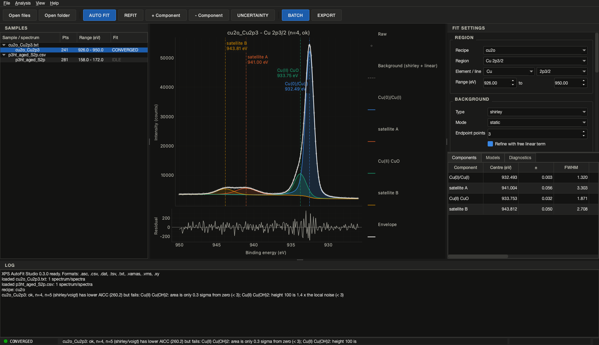
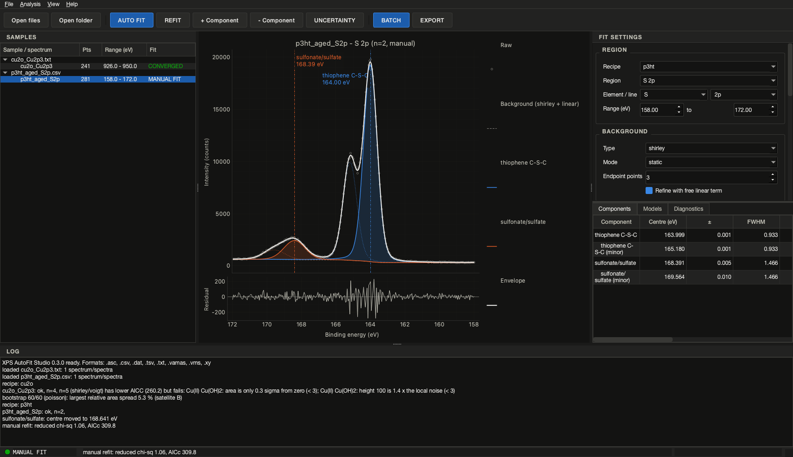

# XPS AutoFit Studio

Automated, reproducible X-ray photoelectron spectroscopy (XPS) peak fitting with
physical constraints, statistical model selection and batch processing.

`xps-autofit` is the analysis engine, the command-line tool and (since v0.2.0) a
desktop application built on the same engine - see the [roadmap](#roadmap).

**What it does**

1. Reads CSV / TXT / tab-separated exports and ISO 14976 VAMAS (`.vms`) files.
2. Normalises the energy axis (ascending binding energy, duplicates merged, kinetic
   energy converted) and records every step.
3. Computes a Linear, Shirley or Tougaard background - static (from the region
   endpoints) or **active**, i.e. generated from the fitted peaks inside the fit so
   that noisy endpoints and peak tails no longer bias it.
4. Fits Gaussian, Lorentzian, Voigt, pseudo-Voigt or asymmetric Doniach-Sunjic
   (metals) components with area-normalised shapes, spin-orbit doublet constraints
   (splitting, area ratio, shared widths), width bounds and candidate windows for
   chemical states.
5. Chooses the number of components - and, on request, the background and the line
   shape - with AICc/BIC **among models that pass physical checks** (positive
   significant areas, centres inside the region, minimum separation) and checks the
   residual for structure (Durbin-Watson, runs test). Ambiguous or non-physical
   results are flagged instead of silently reported.
6. Reports relative composition from RSFs (or `NOT_CALCULABLE` when a factor is
   missing) with bootstrap uncertainties, literature candidates for each component,
   and the modified Auger parameter for Cu.
7. Writes CSV, XLSX, JSON, PNG/SVG/PDF and a project file that reproduces the fit.



## Installation

**Installers** (no Python needed) are attached to every
[release](https://github.com/jongsu-king/xps-autofit-studio/releases): a Windows
setup program and zip, a macOS (Apple Silicon) DMG, and a Debian/Ubuntu `.deb` plus
a portable tar.gz. Each contains the desktop application and the `xps-autofit`
command-line tool. The builds are not code-signed; see `docs/installers.md` for the
SmartScreen / Gatekeeper steps.

From PyPI or the repository:

```bash
pip install xps-autofit            # engine + command line
pip install "xps-autofit[gui]"     # plus the desktop application (PySide6, PyQtGraph)
```

From a clone (development):

```bash
pip install -e ".[dev]"
pytest
```

Requires Python 3.11 or later; NumPy, SciPy, lmfit, pandas, Matplotlib, PyYAML and
openpyxl are installed automatically.

## Quick start

```bash
# Example data with known truth (several formats)
xps-autofit synth --out examples/data

# What is in a file?
xps-autofit info examples/data/p3ht_aged_multi.vms

# Fit with a built-in recipe
xps-autofit fit examples/data/p3ht_aged_S2p.csv --recipe p3ht --output results

# Ad-hoc region: Shirley background, Voigt doublet (S 2p), up to 3 components
xps-autofit fit s2p.csv --range 160 172 --doublet 1.18 0.5 --max-components 3

# Metallic Au 4f: active Shirley background and the asymmetric Doniach-Sunjic line
xps-autofit fit au4f.csv --range 80 92 --doublet 3.67 0.75 \
    --background shirley --background-mode active --shape doniach_sunjic

# Uncertainties: 200 bootstrap replicates, propagated to the atomic percentages
xps-autofit fit sample.vms --recipe cbo --bootstrap 200 --output results

# Same recipe for a whole folder; summary tables compare samples
xps-autofit batch ./spectra --recipe cu2o --output results --formats csv,xlsx,json,png

# Re-run a saved project and confirm the numbers reproduce
xps-autofit verify results/p3ht_aged_S2p__S_2p.json
```

From Python:

```python
from xps_autofit import read_spectra
from xps_autofit.automation.model_selection import select_model
from xps_autofit.recipes import load_recipe

spectrum = read_spectra("p3ht_aged_S2p.csv")[0]
region = load_recipe("p3ht").region("S 2p")
selection = select_model(spectrum, region)
best = selection.best.result
for c in best.components:
    print(c.label, round(c.center, 2), round(c.area), c.fraction)
print(selection.status)       # ok | ambiguous | needs_review | failed
```

## Desktop application

```bash
xps-autofit gui
```

The window follows the layout of instrument software: a sample tree on the left,
the live spectrum in the centre (raw data, background, components with draggable
centre lines, envelope, residual with the ±1σ band, cursor readout), fit settings
and the Components / Models / Diagnostics tabs on the right, a log at the bottom
and a status lamp (IDLE, FITTING, CONVERGED, AMBIGUOUS, NEEDS REVIEW, MANUAL FIT).
AUTO FIT runs the same model selection as the command line in a background
thread; dragging a centre line, editing a cell or adding / removing a component
refits; UNCERTAINTY bootstraps the displayed fit; EXPORT and BATCH write exactly
the files the CLI writes. Files and folders can be dropped on the window; tables
copy to the clipboard. Details and screenshots in `docs/gui.md`.



## Recipes

A recipe is a YAML file with one entry per region: energy range, background,
peak shape, width bounds, doublet definition, candidate chemical states with
windows, the allowed number of components and the RSF. Built-in recipes:

| Recipe      | Regions                                 | Purpose                                              |
|-------------|-----------------------------------------|------------------------------------------------------|
| `p3ht`      | C 1s, S 2p                              | Thiophene S 2p doublet and sulfur oxidation          |
| `cu2o`      | Cu 2p3/2, Cu LMM, O 1s, C 1s            | Cu states, satellites, Auger parameter (Cu(0)/Cu(I)) |
| `cbo`       | Cu 2p3/2, Bi 4f, O 1s, C 1s             | CuBi2O4: Cu/Bi states; composition when RSFs given   |
| `sam_2pacz` | P 2p, N 1s, C 1s, O 1s                  | Phosphonic-acid SAM formation                        |

`xps-autofit recipes --show p3ht` prints a recipe; copy it, edit it and pass the
path with `--recipe my_recipe.yaml`.

Candidate positions and spin-orbit data are typical literature values collected in
`xps_autofit.database`. They constrain fits and suggest assignments; they are not a
substitute for your own references.

## How the automatic fit decides

For each component count *n* from `min_components` to `max_components` the program
fits several starts (detected peaks, residual-guided additions, jittered copies)
and keeps the best. Each model is then checked:

| Check                               | Effect                      |
|-------------------------------------|-----------------------------|
| Area < 3 sigma from zero            | model rejected              |
| Height < 3 x local noise            | model rejected              |
| Centre at the region edge           | model rejected              |
| Two majors closer than `min_separation` | model rejected          |
| Width pinned at a bound             | warning                     |
| Centre outside all candidate windows | warning (or rejection with `require_assignment: true`) |
| Residual autocorrelated (Durbin-Watson < 1) | warning; breaks ties towards the model with a white residual |

Among the accepted models the lowest AICc (default) or BIC wins. If the next model
is within 2 units the result is `ambiguous` and the simpler model is reported -
unless the simpler model leaves a structured residual and the richer one does not.
If nothing passes, the statistically best model is returned with status
`needs_review`. Weighted fits (counts available) use chi-square based criteria;
unweighted fits use the residual-sum-of-squares form. With `background: {type:
auto, mode: auto}` and `shape: auto` the background (static / active Shirley,
Tougaard, linear) and the line shape are chosen the same way. The full procedure
is in `docs/algorithm.md`.

Doublets are one component: the minor line is tied to the major by
`center + splitting`, `area * ratio` and shared widths, so S 2p3/2 and 2p1/2 are
never interpreted as two chemical species.

### Charge referencing

Recipes may define a charge reference (for example adventitious C 1s at 284.8 eV).
It is applied only when that region is present and prints a warning every time:
the adventitious-carbon position varies between samples (Greczynski & Hultman 2020).
Use `--no-charge-correction` to disable it; the applied shift is stored in every
output.

## Outputs

For each file and region (`<file>__<region>`):

- `_components.csv` - centre, FWHM, area with standard errors, fraction, Gaussian /
  Lorentzian widths
- `_fit.csv` - energy, raw, background, net, envelope, residual, each component
- `_models.csv` / `_models.png` - every candidate model with AICc, BIC, chi-square
  and the physical checks
- `.png` / `.svg` / `.pdf` - publication figure with residual panel
- `.json` - project file: data, settings, initial values, parameters, versions
- `.xlsx` - the same tables in one workbook

Per run: `summary_regions.csv`, `summary_components.csv`,
`summary_quantification.csv` (and `summary.xlsx`).

Standard errors come from the covariance matrix (rescaled by reduced chi-square
only for unweighted fits). `--bootstrap N` adds Poisson or residual bootstrap
standard deviations and percentiles (areas, centres, widths, fractions) to the
project file and propagates them to the atomic percentages in
`summary_quantification.csv`.

## File formats

| Format | Notes |
|--------|-------|
| CSV / TSV / TXT / DAT / XY / ASC | Delimiter sniffed; header used to find energy and intensity columns; decimal commas; descending axes; several numeric blocks per file; `Kinetic Energy` columns converted (photon energy from `--photon-energy`, default Al K-alpha 1486.6 eV) |
| VAMAS `.vms` | ISO 14976 NORM / REGULAR and IRREGULAR scans; kinetic energy converted with the source energy; dwell time and scans kept for weights. Files with parameter inclusion/exclusion lists are rejected with a message |

Intensity in **counts** enables Poisson weighting. For **cps** files weights need the
dwell time and number of scans (read from VAMAS, or `dwell_time_s` / `n_scans` from
Python). Otherwise the fit is unweighted and the project says so.

Vendor binary formats are not supported; export VAMAS or ASCII from the instrument
software. Readers for additional formats can be registered with
`xps_autofit.readers.register_reader`.

## Validation

`tests/` contains synthetic-data tests for:

- peak-shape normalisation and FWHM, including the Doniach-Sunjic line and the
  recovery of its asymmetry from a synthetic metallic line
- Shirley recovery of a Shirley-type background; Tougaard endpoint behaviour;
  active Shirley and Tougaard recovering offset and scattering factor
- recovery of centre, area and FWHM of single and overlapping Voigt peaks
- shoulder detection, residual diagnostics and the residual tie-break
- bootstrap propagation to atomic percentages
- preservation of S 2p splitting and area ratio; correct component count on fresh
  and oxidised P3HT-like spectra; no over-fitting at low signal-to-noise
- descending and non-uniform energy axes
- CSV variants, kinetic-energy columns and a VAMAS round trip
- identical results from batch and single runs
- project save / load / verify

Run `pytest` to execute them. Comparisons with real instrument data and with other
programs are part of the v1.0 plan and have not been done yet.

## Roadmap

| Phase | Version | Content |
|-------|---------|---------|
| 1 | v0.1.0 | Fitting core, readers, Shirley/Tougaard, Voigt, doublets, model selection, CLI, exports |
| 2 | v0.2.0 | PySide6 + PyQtGraph desktop app, interactive peak editing |
| 3 | v0.3.0 | Active backgrounds, Doniach-Sunjic line, residual diagnostics, bootstrap composition errors, diagnostics / uncertainty in the app (this release) |
| 3 | v0.5.0 | Element library, RSF libraries, comparison views for sample series |
| 4 | v1.0.0 | Validation against real data and other software (installers already ship with every release) |
| 5 | v2.0 | Depth profiling, PCA, large batches, model recommendation |

## 한국어 요약

XPS 스펙트럼을 불러와 배경 제거(Linear·Shirley·Tougaard, 피크와 함께 피팅하는
능동 배경 포함), Voigt 계열과 금속용 비대칭 Doniach-Šunjić 피팅, 스핀-궤도
이중선 제약, AICc/BIC와 물리 검사·잔차 진단(Durbin-Watson)을 함께 쓰는 자동
모델 선택, 부트스트랩 불확도가 붙은 조성 계산, 논문용 그림과 재현 가능한
프로젝트 파일 저장까지 명령 한 줄로 수행하는 도구입니다. 같은 레시피를 여러
시료에 적용해 피크 수를 임의로 늘리지 않고 비교할 수 있습니다.
`xps-autofit gui`는 계측 장비 소프트웨어 형태의 데스크톱 화면으로, 피크
중심선을 끌어 옮기거나 성분을 더하고 빼며 다시 피팅하고, 진단 탭과 불확도
버튼으로 결과를 점검할 수 있습니다.

## License

MIT. See `LICENSE`. Reference data compiled from public sources are cited in
`xps_autofit/database`.
