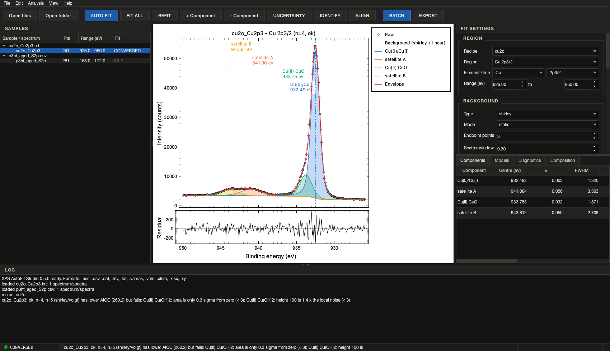
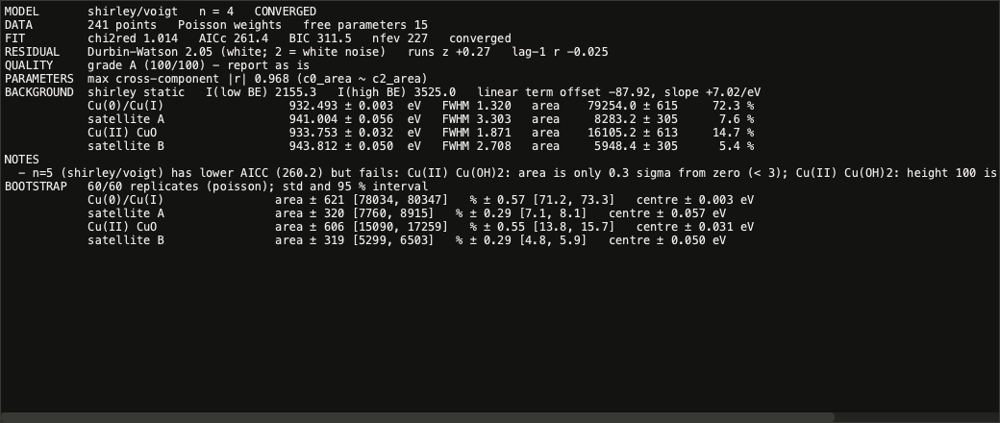
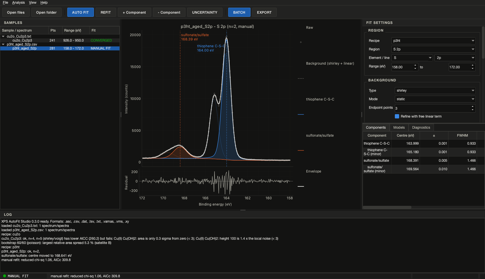
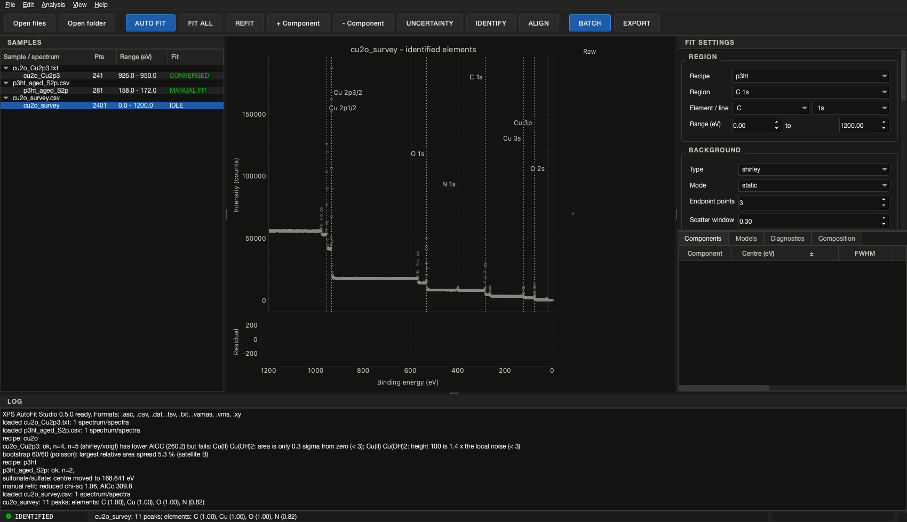
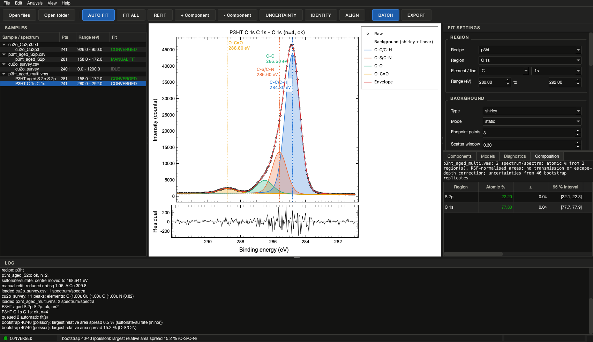
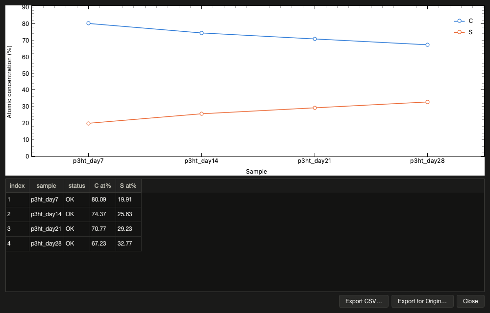
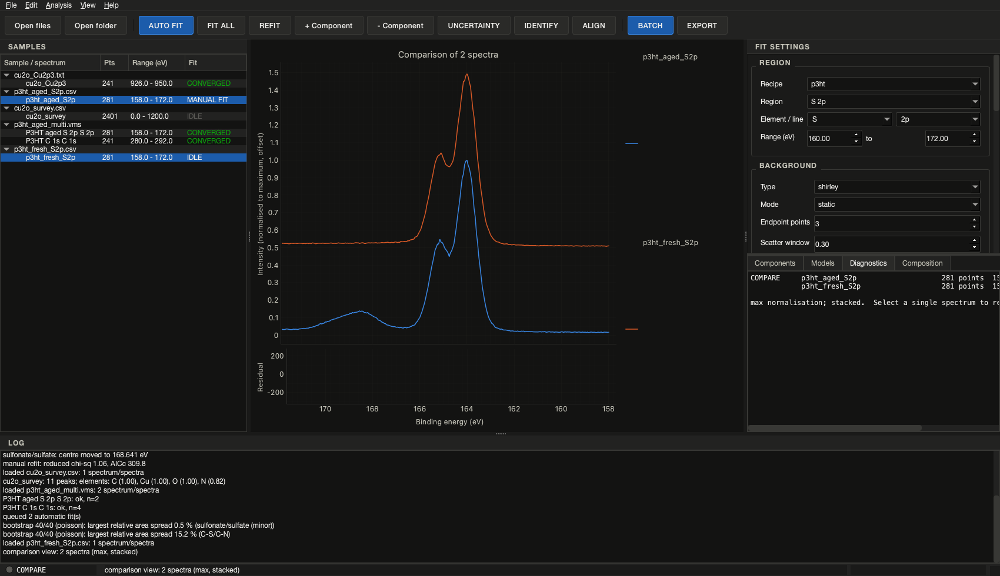
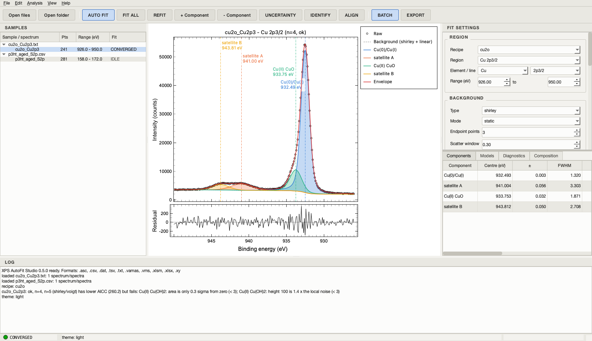
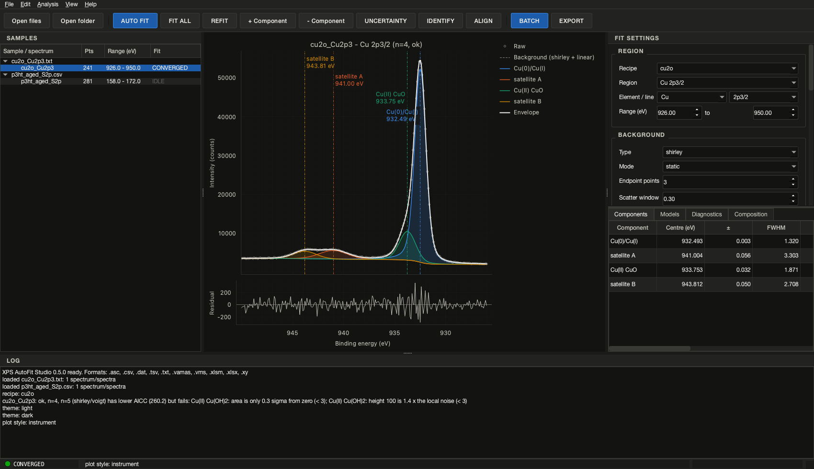

# Desktop application

```bash
pip install "xps-autofit[gui]"
xps-autofit gui
```

The window follows the layout of instrument software: samples on the left, the
live spectrum in the centre, fit settings and result tables on the right, a log at
the bottom and a status lamp in the status bar (IDLE / FITTING / CONVERGED /
AMBIGUOUS / NEEDS REVIEW / FAILED / MANUAL FIT).



## Workflow

1. **Open files…**, **Open folder…**, the **Recent files** menu, or drop files and
   folders onto the window (CSV, TXT, VAMAS, Excel workbooks, …). Each spectrum in a
   file becomes a row under its file in SAMPLES: for a workbook, one row per
   worksheet, per table, or per intensity column, named after the sheet, the table
   title or the column header. **Remove spectrum** (Delete) takes the selected
   row out again.
2. Pick a **Recipe**; the region matching the selected spectrum is chosen
   automatically and its settings fill the panel. Without a recipe the panel is an
   ad-hoc region: set element/line (the doublet is filled from the database), range,
   background type and **mode** (static / active / auto), the **Tougaard**
   cross-section (universal, or polymer for organic films; a recipe's own constants
   show as *custom*), shape (including the
   asymmetric `doniach_sunjic` line with its asymmetry bound), component count and
   width bounds.
3. **AUTO FIT** (F5) runs the full model selection in a background thread. The plot
   shows raw data, background (static + linear refinement, or the active
   background), each component with a draggable centre line, the envelope and the
   residual with the ±1σ band. A hairline cursor follows the mouse in both panels
   and the status bar reads out energy and intensity. The Components tab lists
   centres, FWHM, areas with standard errors, the fraction per chemical component,
   the asymmetry and an **Assignment** suggestion - the reference chemical state of
   the built-in database whose typical range holds the centre (+/- 0.5 eV), with all
   matches and their distances in the tooltip (a suggestion from typical values, not
   an assignment); the Models tab lists every candidate with its variant
   (background / shape), criterion, reduced chi-square, Durbin-Watson statistic and
   the physical checks it failed (click a row to view that model); the
   Diagnostics tab is a monospace readout of the statistics, residual diagnostics,
   background parameters, warnings and notes.

   

4. To adjust: drag a centre line (refits on release when *Refit when a peak is
   dragged* is on), double-click a centre or width cell to type a value, or use
   **+ Component** (placed at the largest residual) and **- Component** (selected
   row). Manual results are labelled MANUAL FIT and keep the automatic candidates
   for comparison.
   - **Names.** Double-click a component's name in the Components tab (or select
     the row and press Shift+F2, *Analysis > Rename component…*) to call it what
     it is (`C-C`, `C-O`, `S(VI)` …). The minor doublet line, the legend, the
     centre-line label, the Diagnostics readout, a bootstrap and every export use
     the new name; nothing is refitted and the fit status does not change. Empty
     and duplicate names are refused (the log says why).
   - **Titles.** Double-click a spectrum in SAMPLES (or F2, *File > Rename
     spectrum…*) to give it a title. It replaces the name read from the file in
     the tree, the plot title, the exported figure and the project file (with a
     `rename` step in the spectrum history); output file names keep the source
     file's stem, so a renamed spectrum still overwrites its own earlier export.
5. **UNCERTAINTY** (F7) bootstraps the displayed fit (Poisson replicates for
   counts, resampled residuals otherwise) and adds standard deviations and 95 %
   intervals of areas, fractions and centres to the Diagnostics tab. The bootstrap
   is cleared when the model changes.
6. **EXPORT** (Ctrl+E) writes the same files as the command line for the current
   spectrum (CSV, XLSX, JSON project, PNG/SVG/PDF in the Origin-style publication
   look, optional bootstrap);
   **Export for Origin…** (Ctrl+Alt+E) writes what is on screen as CSV that
   OriginLab Origin opens as a labelled workbook (Long Name, Units and Comments
   rows): the fit curves and the component table, the X/Y pairs of the comparison
   view, or the bare spectrum. On Windows the file is opened in Origin at once when
   the program is found (`Program Files\OriginLab`, or the path in the
   `XPS_AUTOFIT_ORIGIN` environment variable); otherwise it opens in the default
   program and can be dragged into Origin.
   **Export report (PDF)…** (Ctrl+Alt+R) writes one PDF for the file of the
   selected spectrum: a first page with the file, recipe, version and date, every
   fitted region (status, component count, background / shape, reduced
   chi-square, grade) and the composition with the source of each sensitivity
   factor, then one page per region with the figure, the component table
   (including the suggested chemical state) and the selection notes.
   **Save plot image…** (Ctrl+Shift+S) saves the live view as PNG; **Copy table**
   (Ctrl+Shift+C, or Ctrl+C inside a table) puts the current table on the clipboard
   as tab-separated text for a spreadsheet.
7. **BATCH** (Ctrl+B) applies a recipe to files or folders and shows the summary
   table; the per-file outputs land in the chosen folder.
8. **IDENTIFY** (F8) runs the survey element identification on the selected
   spectrum: the elements whose lines explain the peaks are listed with their
   confidence, matched and missing lines and ambiguities, and the matched lines are
   marked on the spectrum (see `algorithm.md`, section 11). The survey's rough
   composition (one line per element, Shirley-subtracted area over its relative
   intensity) goes to the log and, while the file has no fitted region, to the
   Composition tab. **Analysis > Suggest
   recipe from survey…** then writes a recipe YAML with one region per identified
   element (range around the measured line, database doublet for an unresolved
   p/d/f level, Scofield RSF, C 1s as charge reference) and selects it in the
   Recipe box, ready to edit and to use with FIT ALL or BATCH.
9. **FIT ALL** (Shift+F5) queues an automatic fit for every loaded spectrum: the
   recipe region is matched by energy range for each one, the selected spectrum
   uses the panel settings exactly as AUTO FIT does. The lamp shows the running
   fit and the SAMPLES column fills in as the queue drains.
10. **ALIGN** (Ctrl+Shift+A) is the charge correction. With the reference region
    fitted (usually C 1s), it asks for the reference binding energy (the recipe's
    `charge_reference` value, 284.8 eV by default) and shifts *every spectrum of
    the same file* so that the chosen component - the selected table row, else the
    recipe's reference component, else the largest line - sits at that energy. The
    shift is written to each spectrum's history (`charge correction: ...`) and so
    to the project files, the regions that had a fit are refitted, and the
    adventitious-carbon caveat is logged.
11. **Undo / Redo** (Ctrl+Z / Ctrl+Shift+Z, *Edit* menu) step through the manual
    edits of the displayed spectrum: drags, typed values, added or removed
    components and renames. A new AUTO FIT starts a new history.







## Composition

The **Composition** tab turns the fitted regions of the current file into atomic
percentages, with the arithmetic of the batch summary: the area of each region
(doublet total or major line, as the recipe's `rsf_applies_to` says) divided by
its RSF - an instrument library's value when one is loaded (*Analysis > RSF
library…*, CSV `element,line,rsf` or YAML; remembered; *Use the recipe's RSFs*
clears it), else the recipe's value or, failing that, the Scofield cross-section from the
built-in table, with the source shown - and by `KE^(a + b)` when the recipe asks
for the escape-depth / transmission correction (`algorithm.md`, section 12). The
kinetic energy of each line, the atomic percentages and, when every region has a
bootstrap, their standard deviations and 95 % intervals are listed; a missing
factor makes the sample `NOT_CALCULABLE` and the row red rather than guessed.
*Copy table* puts it on the clipboard. A survey that has been through IDENTIFY and
has no fitted region shows its survey estimate here instead, marked as such.

## Composition series

**Analysis > Composition series…** (Ctrl+Shift+T) collects the composition of every
loaded file - its fitted regions as in the Composition tab, or the survey estimate
of an identified survey - into one table in natural name order (`cycle2` before
`cycle10`) and plots the atomic percent of each element against the sample, with
error bars when bootstraps exist: a depth profile or an ageing series at a glance.
*Export CSV…* writes the table, *Export for Origin…* the same with Origin's label
rows (opened in Origin when it is installed).



## Comparison view

Select two or more spectra in SAMPLES (Ctrl- or Shift-click) and the plot shows
their raw data together, each in its own colour with the titles in the legend.
*View > Compare* switches between raw intensities, normalisation to the maximum
or to the area, and a stacked (offset) waterfall for sample series and depth
profiles; **Save plot image…** exports the view. Selecting a single spectrum
returns to its fit.



## Themes and plot style

*View > Theme* switches between the dark instrument theme and a light theme; both
use the same layout and the figures' validated palette. *View > Plot style*
chooses how the live plot draws itself, independently of the theme:

- **Origin-style** (default): a publication look in the manner of OriginLab
  graphs. White canvas, black frame on all four sides with inward ticks, Arial tick
  and axis labels, no grid, open black data symbols, a red envelope, a grey dashed
  background, filled components and a boxed legend. **Save plot image…** exports
  exactly this view.
- **Instrument**: the canvas follows the theme (dark or light), with a grid and
  axes on the left and bottom only.

Both choices are remembered between sessions. Switching redraws the current fit
with its draggable centre lines, element marks and title.

*View > Plot options…* (Ctrl+Shift+P) edits what the style does not decide: a title
that replaces the automatic one, the axis labels, tick and axis-label sizes, the
data-symbol size, the envelope width, the component fill opacity, whether the
legend, the fills and the centre-line labels are shown, and fixed x / y ranges.
The settings persist and *Restore defaults* clears them.





## Robustness and quality

The *Robustness* group of the settings panel selects the loss function
(`linear` or a robust loss with its scale) and the spike mask; both are explained
in `algorithm.md`, section 10. The *Scatter window* of the BACKGROUND group
(enabled for active and auto modes) bounds the scattering factor of an active
background around its endpoint estimate (`algorithm.md`, section 1; 0 = free).
The Models tab carries a **Grade** column (A-E) and the Diagnostics tab a QUALITY
line with every deduction, and a PARAMETERS line with the largest cross-component
correlation, the number of masked points and the loss in use.

## Fixing parameters

The Components table has two check-box columns, **Fix C** and **Fix W**. Ticking
*Fix C* holds the centre of that component where it is (drag the line to put it
somewhere else: the refit keeps it exactly there); *Fix W* holds its widths
(FWHM G and L, or the GL width). Every change refits the other parameters, counts
as a manual edit (undo works) and is written into the project and session files
(`vary_center`, `vary_width` of the component spec), so a batch run from such a
project reproduces the locked fit.

## Saving the settings as a recipe

*File > Save settings as recipe…* writes the panel's region for the current
spectrum (range, background, shape, constraints, doublet, component counts) as a
YAML recipe, together with the other regions of the recipe in use, so the file is
complete for the sample. When the spectrum is fitted you can add the fitted
components as candidate states (centre windows of ±0.5 eV) and fix the component
count, which turns an interactively refined fit into a reproducible recipe for
`batch`. The file is selected in the Recipe box at once.

## Session files

**File > Save session…** (Ctrl+S) writes a `.xpsession` file with the open spectrum
files, each spectrum's title and charge shift, the recipe in use and, for every
fitted spectrum, the same content as its project file (data, settings, start
values, parameters). **File > Open session…** (Ctrl+Shift+O) reads the files
again, re-applies titles and shifts, selects the recipe and rebuilds each fit by
re-running it from its stored start, so the parameters come back exactly; the
candidate-model table and bootstrap replicates are not stored (AUTO FIT and
UNCERTAINTY recreate them). Missing files and spectra are reported in the log and
the rest is restored.

## Updates

At most once a day, when *Help > Check for updates at startup* is on, the
application asks the GitHub Releases API for the latest version (one anonymous
request; nothing but the version string is sent). A newer release appears as a
clickable link in the status bar that opens the installer for the running
operating system, or the release page. *Help > Check for updates…* runs the check
on demand with *Download*, *Skip this version* and *Later*. Managed installations
can disable the check with the environment variable
`XPS_AUTOFIT_NO_UPDATE_CHECK=1`; the engine, the command line and batch runs never
check unless `xps-autofit update-check` is called.

## Notes

- Fits run on a worker thread; the window stays responsive and the lamp blinks
  while FITTING. One job runs at a time.
- The GUI never computes anything itself: every number comes from the same
  functions the CLI uses (`select_model`, `fit_peaks`, `bootstrap`,
  `write_region_outputs`, `run_batch`), so results are identical.
- Settings such as the last folder and the recent-files list are stored with
  `QSettings` ("xps-autofit", "studio").
- Fits run one at a time; FIT ALL and the refits after ALIGN wait in a queue
  behind the running job.
- Headless testing: set `QT_QPA_PLATFORM=offscreen` and construct
  `MainWindow(synchronous_jobs=True)`; see `tests/test_gui.py`,
  `tests/test_gui_features.py`, `tests/test_gui_v04.py`, `tests/test_rename.py`
  and `tests/test_gui_v05.py`. The screenshots on this page are produced the same
  way by `examples/make_screenshots.py`.
